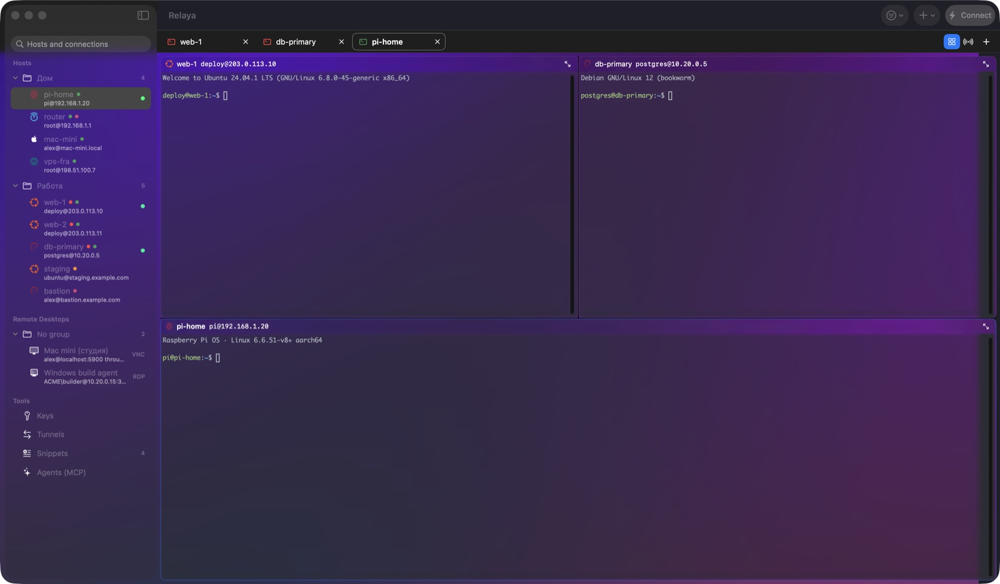
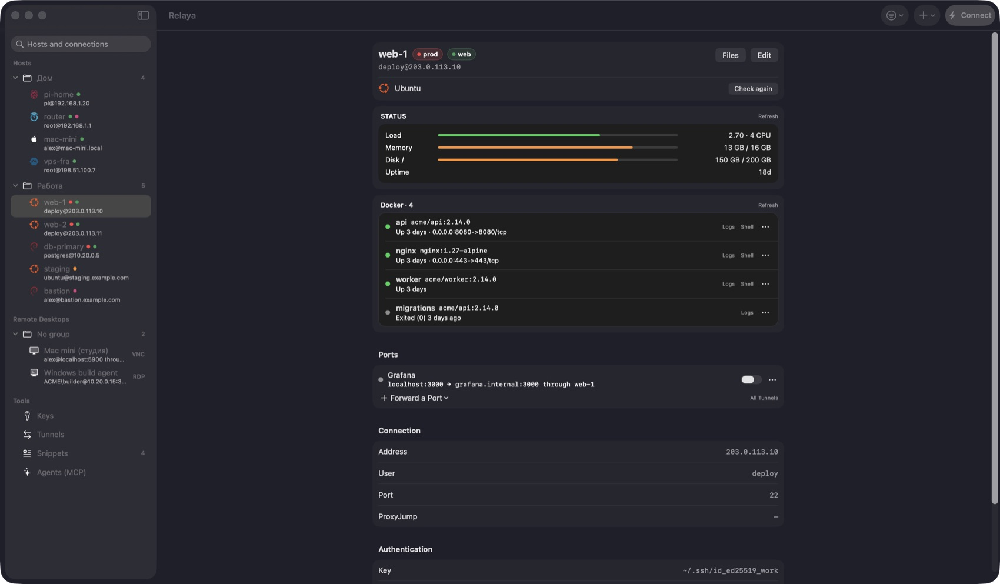
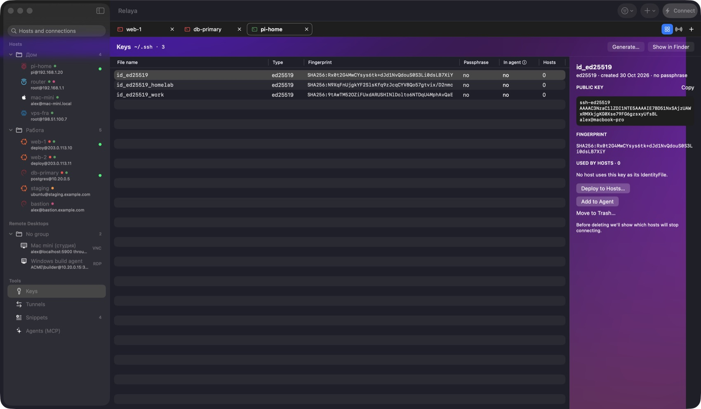
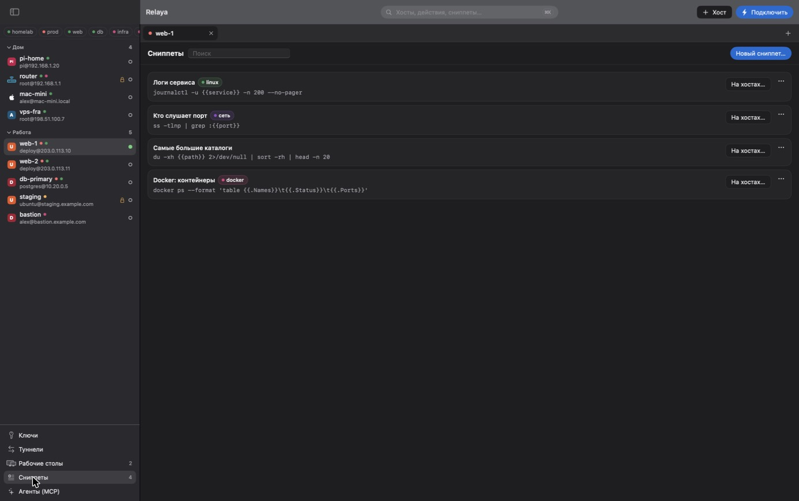
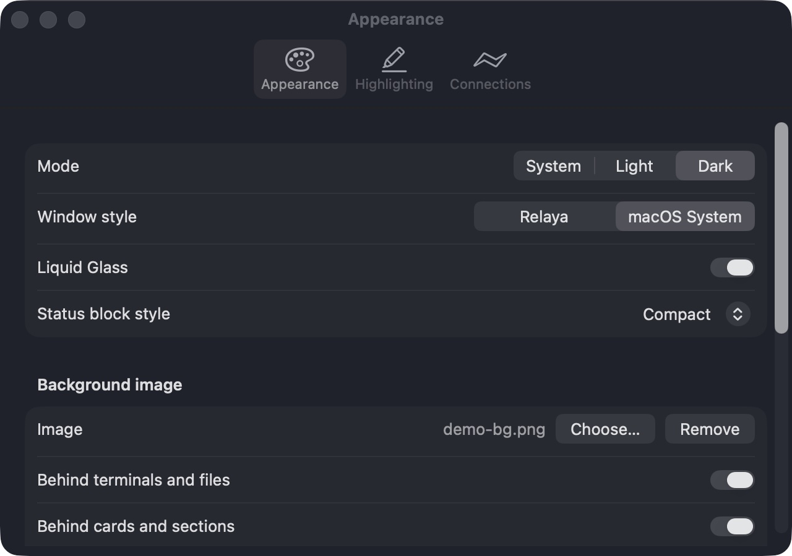

<p align="center"></p>

<h1 align="center">Relaya</h1>

<p align="center">
  A native SSH client for macOS and Windows (Linux in progress) where your keys live in <code>~/.ssh</code> — not in our vault.
</p>

<p align="center">
  <a href="https://github.com/hvckfy/Relaya/releases/latest"></a>
  <a href="https://github.com/hvckfy/Relaya/actions/workflows/ci.yml"></a>
  
  
  <a href="LICENSE"></a>
</p>

---

Relaya is a free, open source alternative to Termius-style SSH managers: SwiftUI on macOS, WinUI 3 on Windows, Uno Platform on Linux (in progress), one shared Rust core. It has **no proprietary storage and no vendor cloud**:

- your host list **is** your `~/.ssh/config`,
- your keys are plain files in `~/.ssh`,
- passwords and passphrases live in the macOS **Keychain** / Windows **Credential Manager** / Linux **Secret Service**,
- optional sync goes through **your own** git repository or folder.

Everything you set up in Relaya keeps working from Terminal, PowerShell, VS Code, git, Ansible — anything that speaks SSH.

## Screenshots

<p align="center"></p>

| Host card | Keys |
|---|---|
|  |  |
| **Snippets** | **Appearance** |
|  |  |

<sub>All hosts and keys above are fictional — screenshots are taken with `Relaya --demo`.</sub>

## Features

**Hosts**
- Add, edit, duplicate and delete hosts directly in `~/.ssh/config`. Every change is shown as a diff first and backed up to `config.bak`; comments and directives Relaya doesn't manage are preserved.
- Groups and free-form tags, stored as a comment above the host (`# relaya: group=work tags=prod,db`) — ssh ignores it.
- A Finder-style sidebar: Hosts, Remote Desktops and Tools sections with collapsible groups, search and a tag filter. Git-hosting entries (GitHub, GitLab, `User git`…) are kept out of the host list.
- A **Host** menu in the menu bar with every action for the selected host.
- **Command palette (⌘K)**: fuzzy search over hosts, remote desktops, layouts, snippets, tunnels and actions.

**Passwords & keys**
- Passwords live in Keychain and are typed in automatically when ssh asks for the login password — after **Touch ID** (or your Mac password). They never appear in process arguments or environment variables.
- After login, a password prompt (`sudo`, `su`, `mysql -p`…) gets a one-click "Fill in" banner instead of automatic input, again behind Touch ID; broadcast input pauses while a password is being typed.
- Hosts whose ssh runs programs from `~/.ssh/config` (`ProxyCommand`, `LocalCommand`, `KnownHostsCommand`, `Match exec`) never get a saved password automatically — those programs would inherit it.
- Optional: ask Touch ID for **every** use of a saved password by ssh (tunnels, files, host panels, agents).
- **"Set up key login" wizard**: generates an ed25519 key, installs it on the server (OpenWrt/Dropbear too), verifies a passwordless login and only then updates your config.
- **Keys screen**: every key pair in `~/.ssh` with fingerprints, agent status and the hosts using it. Choose which hosts and **git servers** (GitHub, GitLab, your own Forgejo) use a key — Relaya writes `IdentityFile` + `IdentitiesOnly yes`, which fixes "Too many authentication failures".
- Errors from ssh, git, RDP and VNC are explained in plain words: what happened and what to do.

**Terminal**
- Tabs, host-key fingerprint check on first connect, a loud warning when a server's key changes, auto-reconnect, find (⌘F), output highlighting.
- **Tiles**: drag a tab onto the edge of another terminal and it docks there; drag it to the edge of the window to span the full width or height. Splits are resizable and never overlap. SFTP tabs tile too. Each tile shows where it's connected.
- **Keyboard splits** like iTerm2: ⌘D splits right, ⇧⌘D splits down, ⌥⌘arrows move between tiles. Save a set of tiles as a **layout** and reopen it in one go.
- **Session recording** (⌥⌘L) to a plain-text log in `~/Documents/Relaya Logs`.
- **Links**: ⌘-click opens URLs; `localhost:PORT` links (and ports detected in output) open the *server's* port in your browser through a temporary tunnel.
- **Broadcast input**: type into several terminals at once (passwords and snippets are never broadcast).
- **tmux sessions**: reconnect straight back into the same session. Closing a tab ends it; after a dropped connection the server closes it by itself after an idle timeout (1 hour by default), so sessions never pile up. Turn tmux on or off in an open tab, keep a session running on purpose for 24 hours, see and clean up sessions in the host card.
- **tmux control mode**: show every window of a tmux session on the server as a Relaya tab.

**Files**
- SFTP browser with a transfer queue: progress, speed, cancel and retry. Uploads go to a temporary file first, so a broken transfer never corrupts the original.
- **Open in Editor**: edit a remote file in your default editor — every save is uploaded back.
- Drag & drop from Finder, rename, new folder, delete, keyboard shortcuts.
- **Open in Finder**: mount any server folder (`/` by default) as a volume in Finder through a local WebDAV bridge — no kernel extensions, nothing to install.

**Host card**
- Live status: load, memory, disk, uptime — in one of four styles (tiles, compact, pixel, console).
- **Docker**: containers with status and ports; logs, a shell inside, start/stop/restart.
- **Services, ports, journal, updates**: systemd services (failed first, filter, logs, restart/stop/start with confirmation), listening ports, recent journal errors and pending package updates — over plain ssh, no agent on the server.
- Port forwarding presets and OS-specific actions.
- Server OS detection with distro logos (Ubuntu, Debian, Proxmox VE, OpenWrt, Fedora, Arch, Alpine, Mint, Kali and more).

**Tunnels & snippets**
- Local (`-L`), remote (`-R`) and SOCKS (`-D`) tunnels with start/stop, auto-start and a menu bar icon.
- Snippets with `{{variables}}`: insert with ⇧⌘P or run on several hosts at once.

**Remote desktops**
- Built-in **VNC** and **RDP** (NLA) viewers in a tab or a separate window, optionally through an SSH tunnel; passwords in Keychain. RDP resolution adapts to the window on the fly.

**AI agents (MCP)**
- `Relaya --mcp` is a local MCP server for Claude, Cursor and other clients: `list_hosts`, `run_command`, `read_file`.
- Per-host access: off, read-only, confirm each command, or trusted. Confirmation is a **Touch ID** prompt showing the exact command. Agents never see your keys.
- **Rules**: command patterns that run without confirmation and patterns that are always forbidden (even for trusted agents); **temporary access** ("trusted for 30 minutes"); a **"what agents changed"** summary per agent session and command output in the log.

**Sync (free, no cloud of ours)**
- Sync profiles: each has its own git repository (your own server over SSH, Gitea, GitLab, GitHub) or an iCloud Drive folder, and its own hosts — all of them, chosen groups or individual hosts.
- Hosts, their tunnels, remote desktops, and snippets are merged three-way (git or folder); agent permissions (`mcp.json`, profiles that sync all hosts) are taken from the incoming side as a whole file; deletions sync too, an edit wins over a deletion, and a machine with an empty config never wipes the shared one. `~/.ssh/config` is backed up before every change.
- Conflicts show both versions side by side. SSH keys sync only if you ask, only for the profile's hosts, encrypted with your password; a key that differs from yours is saved next to it as `.from-sync`, and keys skipped for a missing password are reported. Server passwords are never synced.
- Note: anyone who can write to your sync repository or folder controls the synced data — use a private repository.

**Looks**
- Relaya themes or the native macOS style, **Liquid Glass** on macOS 26, light/dark/system.
- A background image shared by the whole workspace — tiles, terminals and panels show it through, with adjustable opacity.
- Terminal color schemes and fonts. English and Russian builds (the language is fixed per download).

**Plain system ssh**
- Sessions run `/usr/bin/ssh`, so ProxyJump, ssh-agent, FIDO keys and every config option behave exactly like in Terminal.app.

## Installation

### macOS

1. Download `Relaya-vX.Y.Z-macos-en.zip` (English) or `Relaya-vX.Y.Z-macos-ru.zip` (Russian) from [Releases](https://github.com/hvckfy/Relaya/releases/latest).
2. Unzip and move `Relaya.app` to `/Applications`.
3. Builds are signed with a persistent self-signed certificate (Keychain permissions survive updates) but not notarized, so remove the quarantine flag once:

```bash
xattr -dr com.apple.quarantine /Applications/Relaya.app
```

Requires macOS 14 Sonoma or later; Liquid Glass needs macOS 26. Universal binary (Apple Silicon and Intel).

### Windows (preview)

1. Download `Relaya-X.Y.Z-windows-x64-en-setup.exe` (English) or `…-ru-setup.exe` (Russian) from [Releases](https://github.com/hvckfy/Relaya/releases/latest) and run it. It installs for the current user (no admin rights), adds a Start menu shortcut and an entry in *Settings → Apps* to uninstall. Portable `…-windows-x64-<lang>.zip` builds are there too.
2. The installer isn't code-signed yet, so SmartScreen asks once: *More info → Run anyway*.
3. Needs Windows 10 1809+ (Mica background on Windows 11) and the built-in **OpenSSH Client** (*Settings → Apps → Optional features*). Sync needs [Git for Windows](https://git-scm.com).

The Windows client shares the core with macOS: the same `~/.ssh/config`, snippets, tunnels, remote desktops, AI-agent rules and sync format. It has its own native terminal (Rust emulator + Win2D), tiles, host card with live status, Docker, tmux and services, SFTP, keys, tunnels, Windows Hello confirmation, RDP (via Remote Desktop Connection for now) and VNC (via an installed viewer). In progress: a built-in RDP tab on FreeRDP (H.264, sound, clipboard, RD Gateway). Not yet on Windows: session recording.

### Linux (in progress)

A Linux client on Uno Platform (X11, Wayland via XWayland) sharing the Windows C# code is being built: terminal, Secret Service passwords and the hardened askpass are done; packages (AppImage, .deb) will appear in Releases when it's ready.

## Keyboard shortcuts

macOS (on Windows: Ctrl+Shift+C/V copy/paste, Ctrl+Shift+F find, Ctrl+Shift+D/W split/close tile, Ctrl+W close tab, Ctrl+Tab next tab, Ctrl+K search hosts, Ctrl+click opens links):

| Action | Shortcut |
|---|---|
| New host | ⇧⌘N |
| Connect to selected host | ⌘T or double-click |
| Close tab | ⌘W |
| Switch tab | ⌘1 … ⌘9 |
| Reconnect | ⌘R |
| Find in terminal | ⌘F |
| Edit / duplicate host | ⌘E / ⌘D |
| Open files (SFTP) | ⇧⌘O |
| Command palette | ⌘K |
| Split right / down | ⌘D / ⇧⌘D |
| Move between tiles | ⌥⌘ ← → ↑ ↓ |
| Record session | ⌥⌘L |
| Snippets | ⇧⌘P |
| Reload `~/.ssh/config` | ⇧⌘R |
| Settings | ⌘, |

## Security model

- **Nothing is written without confirmation.** Config edits, new key files and server changes are previewed as a diff first.
- **Secrets stay in Keychain / Credential Manager / Secret Service.** For non-interactive operations (tunnels, SFTP, host panels, installing a key) ssh receives the secret through an askpass helper — Relaya itself, launched by ssh. The process that started ssh hands out a one-time token over a private socket (named pipe on Windows) and gives the secret only to its own ssh child for a real password prompt; the Keychain entry name is never in the environment, so other programs of the same user can't ask for it.
- **Known limitation:** `ssh-keygen` only accepts a new key's passphrase as an argument, so it is briefly visible in the process list while the key is generated.
- **Server changes only after confirmation.** Disabling password login, for example, asks first, shows the command and warns if the host has no key; OS actions are inserted into the terminal without Enter.
- **AI agents need your approval.** On hosts in "confirm" mode every command is shown in a Touch ID prompt (a system confirmation dialog on Windows).

## Repository layout

```
core/                 Rust core (relaya-core): ~/.ssh/config, sync, MCP policy, terminal emulator, …
                      shared by every client through UniFFI bindings; tested on macOS, Linux and Windows
apps/swift/           Apple clients — SwiftPM package: macOS app now; iOS/iPadOS later share
                      RelayaCore (Swift facades over the core) and the SwiftUI code here
apps/dotnet/          .NET clients: Relaya.Shared (pages, terminal, sync — common C#), Relaya.Windows (WinUI 3),
                      Relaya.Linux (Uno Platform, in progress), installer (Inno Setup)
resources/            shared assets: localization (ru/en strings), app icon sources
scripts/              build-core-macos.sh, bundle-macos.sh [version] [ru|en], build-core-windows.ps1, build-core-linux.sh
docs/                 UI spec, design notes, screenshots
.github/workflows/    ci (macOS), core (Rust on 3 OSes), windows, linux, freerdp, freerdp-watch, release
```

## Building from source

macOS (needs Xcode 26 and Rust):

```bash
git clone https://github.com/hvckfy/Relaya.git
cd Relaya
scripts/build-core-macos.sh
cd apps/swift
swift build
swift test
swift run Relaya
```

To produce a universal `.app` bundle: `scripts/bundle-macos.sh 0.1.0` → `build/Relaya.app` with both languages, or `scripts/bundle-macos.sh 0.1.0 en` → `build/en/Relaya.app` with one. Releases are built by GitHub Actions on every `v*` tag.

Windows (needs Rust, .NET 10 and Visual Studio 2022 with the WinUI workload): run `scripts/build-core-windows.ps1`, then build `apps/dotnet/Relaya.Windows/Relaya.Windows.csproj` with MSBuild (add `-p:RelayaLang=en` or `ru` for a single-language build); `apps/dotnet/installer/Relaya.iss` (Inno Setup 6) builds the installer.

Linux (needs Rust and .NET 10): `scripts/build-core-linux.sh`, then `dotnet publish apps/dotnet/Relaya.Linux -r linux-x64`.

See [docs/UI_SPEC.md](docs/UI_SPEC.md) for the full UI specification (in Russian).

## Contributing

Issues and pull requests are welcome. Please keep the core idea intact: `~/.ssh` stays the source of truth, and every change to files or servers is shown before it is applied.

## License

[MIT](LICENSE) © 2026 hvckfy and Relaya contributors.

Relaya uses [SwiftTerm](https://github.com/migueldeicaza/SwiftTerm), [RoyalVNCKit](https://github.com/royalapplications/royalvnc) and [RDPKit](https://github.com/steelbrain/RDPKit) (MIT) on macOS; [alacritty_terminal](https://github.com/alacritty/alacritty) (Apache-2.0), [FreeRDP](https://github.com/FreeRDP/FreeRDP) (Apache-2.0) and [UniFFI](https://github.com/mozilla/uniffi-rs) (MPL-2.0) in the core; [Win2D](https://github.com/microsoft/Win2D) on Windows and [Uno Platform](https://github.com/unoplatform/uno) on Linux. H.264 on macOS/Linux uses OpenH264 Video Codec provided by Cisco Systems, Inc., downloaded only when you turn it on. Distro logos are from [Simple Icons](https://simpleicons.org) (CC0); they are trademarks of their owners.
