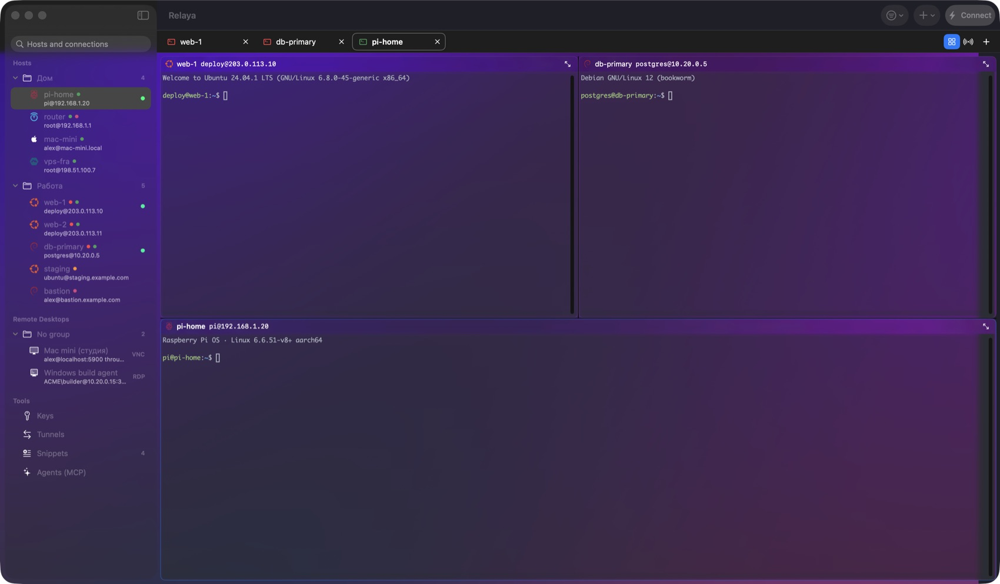
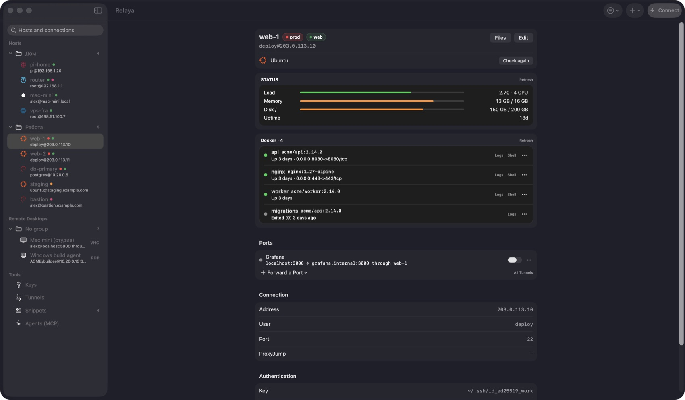
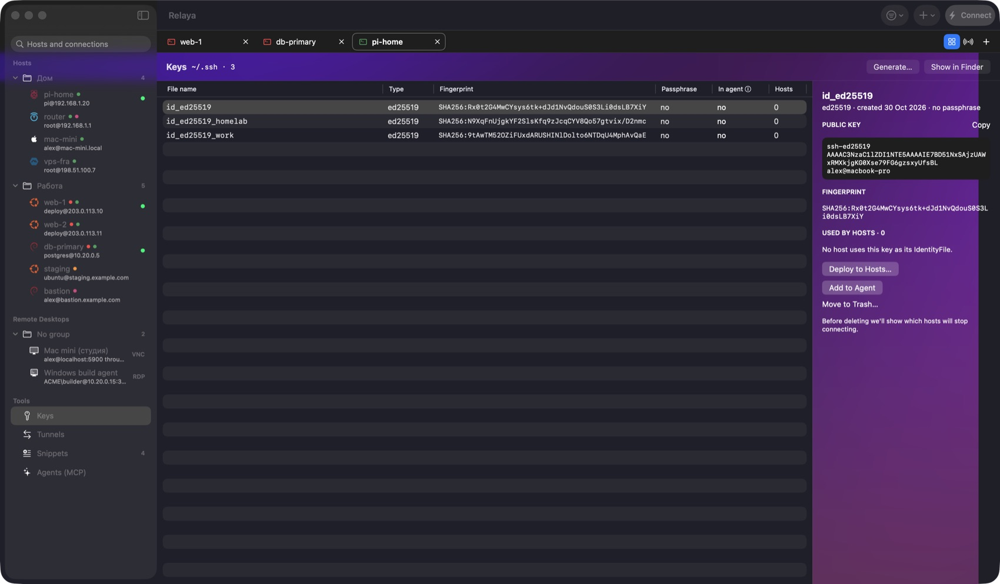
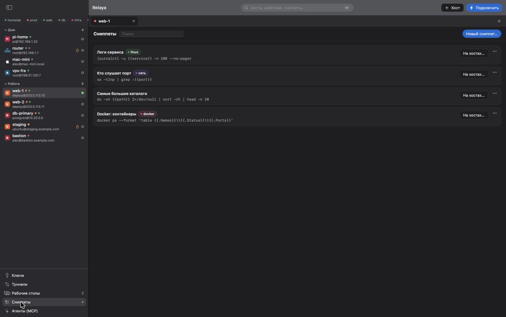
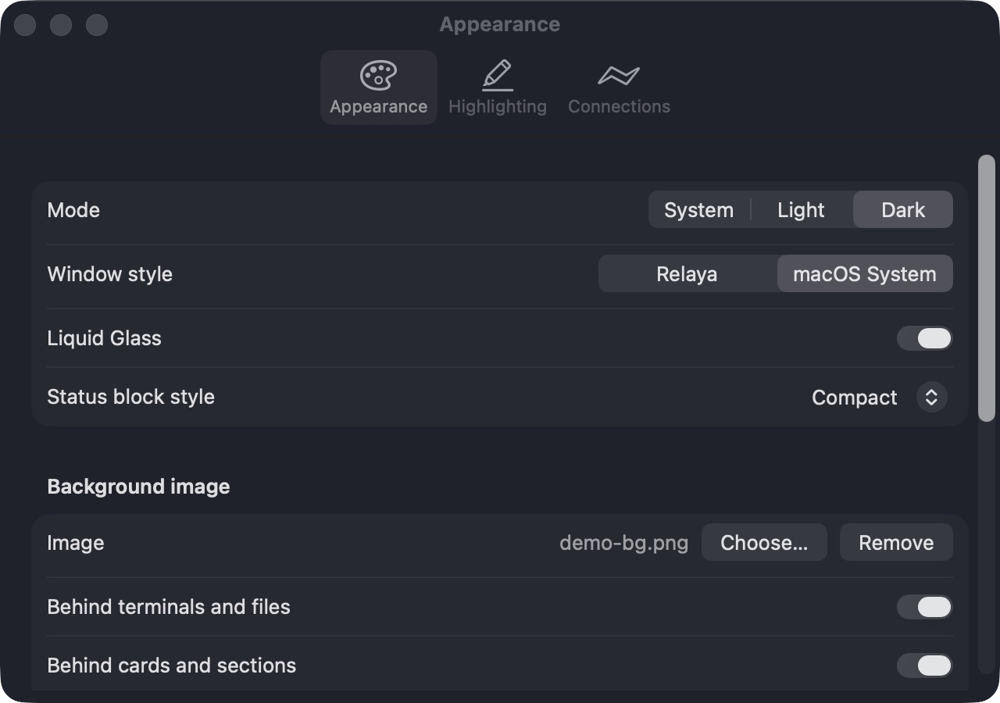

<p align="center"></p>

<h1 align="center">Relaya</h1>

<p align="center">
  A native SSH client for macOS and Windows where your keys live in <code>~/.ssh</code> — not in our vault.
</p>

<p align="center">
  <a href="https://github.com/hvckfy/Relaya/releases/latest"></a>
  <a href="https://github.com/hvckfy/Relaya/actions/workflows/ci.yml"></a>
  
  
  <a href="LICENSE"></a>
</p>

---

Relaya is a free, open source alternative to Termius-style SSH managers: SwiftUI on macOS, WinUI 3 on Windows, one shared Rust core. It has **no proprietary storage and no vendor cloud**:

- your host list **is** your `~/.ssh/config`,
- your keys are plain files in `~/.ssh`,
- passwords and passphrases live in the macOS **Keychain** / Windows **Credential Manager**,
- optional sync goes through **your own** git repository or folder.

Everything you set up in Relaya keeps working from Terminal, PowerShell, VS Code, git, Ansible — anything that speaks SSH.

## Screenshots

<p align="center"></p>

| Host card | Keys |
|---|---|
|  |  |
| **Snippets** | **Appearance** |
|  |  |

<sub>All hosts and keys above are fictional — screenshots are taken with `Relaya --demo`.</sub>

## Features

**Hosts**
- Add, edit, duplicate and delete hosts directly in `~/.ssh/config`. Every change is shown as a diff first and backed up to `config.bak`; comments and directives Relaya doesn't manage are preserved.
- Groups and free-form tags, stored as a comment above the host (`# relaya: group=work tags=prod,db`) — ssh ignores it.
- A Finder-style sidebar: Hosts, Remote Desktops and Tools sections with collapsible groups, search and a tag filter. Git-hosting entries (GitHub, GitLab, `User git`…) are kept out of the host list.
- A **Host** menu in the menu bar with every action for the selected host.
- **Command palette (⌘K)**: fuzzy search over hosts, remote desktops, layouts, snippets, tunnels and actions.

**Passwords & keys**
- Passwords live in Keychain and are typed in automatically when the server asks — after **Touch ID** (or your Mac password). They never appear in process arguments or environment variables.
- **sudo** prompts get a one-click "Fill in" from Keychain, again behind Touch ID.
- **"Set up key login" wizard**: generates an ed25519 key, installs it on the server (OpenWrt/Dropbear too), verifies a passwordless login and only then updates your config.
- **Keys screen**: every key pair in `~/.ssh` with fingerprints, agent status and the hosts using it.

**Terminal**
- Tabs, host-key fingerprint check on first connect, a loud warning when a server's key changes, auto-reconnect, find (⌘F), output highlighting.
- **Tiles**: drag a tab onto the edge of another terminal and it docks there; drag it to the edge of the window to span the full width or height. Splits are resizable and never overlap. SFTP tabs tile too. Each tile shows where it's connected.
- **Keyboard splits** like iTerm2: ⌘D splits right, ⇧⌘D splits down, ⌥⌘arrows move between tiles. Save a set of tiles as a **layout** and reopen it in one go.
- **Session recording** (⌥⌘L) to a plain-text log in `~/Documents/Relaya Logs`.
- **Links**: ⌘-click opens URLs; `localhost:PORT` links (and ports detected in output) open the *server's* port in your browser through a temporary tunnel.
- **Broadcast input**: type into several terminals at once (passwords and snippets are never broadcast).
- **tmux sessions**: reconnect straight back into the same session. Closing a tab ends it; after a dropped connection the server closes it by itself after an idle timeout (1 hour by default), so sessions never pile up. Turn tmux on or off in an open tab, keep a session running on purpose for 24 hours, see and clean up sessions in the host card.
- **tmux control mode**: show every window of a tmux session on the server as a Relaya tab.

**Files**
- SFTP browser with a transfer queue: progress, speed, cancel and retry. Uploads go to a temporary file first, so a broken transfer never corrupts the original.
- **Open in Editor**: edit a remote file in your default editor — every save is uploaded back.
- Drag & drop from Finder, rename, new folder, delete, keyboard shortcuts.
- **Open in Finder**: mount any server folder (`/` by default) as a volume in Finder through a local WebDAV bridge — no kernel extensions, nothing to install.

**Host card**
- Live status: load, memory, disk, uptime — in one of four styles (tiles, compact, pixel, console).
- **Docker**: containers with status and ports; logs, a shell inside, start/stop/restart.
- **Services, ports, journal, updates**: systemd services (failed first, filter, logs, restart/stop/start with confirmation), listening ports, recent journal errors and pending package updates — over plain ssh, no agent on the server.
- Port forwarding presets and OS-specific actions.
- Server OS detection with distro logos (Ubuntu, Debian, Proxmox VE, OpenWrt, Fedora, Arch, Alpine, Mint, Kali and more).

**Tunnels & snippets**
- Local (`-L`), remote (`-R`) and SOCKS (`-D`) tunnels with start/stop, auto-start and a menu bar icon.
- Snippets with `{{variables}}`: insert with ⇧⌘P or run on several hosts at once.

**Remote desktops**
- Built-in **VNC** and **RDP** (NLA) viewers in a tab or a separate window, optionally through an SSH tunnel; passwords in Keychain. RDP resolution adapts to the window on the fly.

**AI agents (MCP)**
- `Relaya --mcp` is a local MCP server for Claude, Cursor and other clients: `list_hosts`, `run_command`, `read_file`.
- Per-host access: off, read-only, confirm each command, or trusted. Confirmation is a **Touch ID** prompt showing the exact command. Agents never see your keys.
- **Rules**: command patterns that run without confirmation and patterns that are always forbidden (even for trusted agents); **temporary access** ("trusted for 30 minutes"); a **"what agents changed"** summary per agent session and command output in the log.

**Sync (free, no cloud of ours)**
- Sync profiles: each has its own git repository (your own server over SSH, Gitea, GitLab, GitHub) or an iCloud Drive folder, and its own hosts — all of them, chosen groups or individual hosts.
- Hosts, their tunnels, remote desktops, snippets and agent permissions merge without deleting anything; `~/.ssh/config` is backed up before every change.
- Conflicts show both versions side by side. SSH keys sync only if you ask, only for the profile's hosts, encrypted with your password. Server passwords are never synced.

**Looks**
- Relaya themes or the native macOS style, **Liquid Glass** on macOS 26, light/dark/system.
- A background image shared by the whole workspace — tiles, terminals and panels show it through, with adjustable opacity.
- Terminal color schemes and fonts. English and Russian UI.

**Plain system ssh**
- Sessions run `/usr/bin/ssh`, so ProxyJump, ssh-agent, FIDO keys and every config option behave exactly like in Terminal.app.

## Installation

### macOS

1. Download `Relaya-vX.Y.Z.zip` from [Releases](https://github.com/hvckfy/Relaya/releases/latest).
2. Unzip and move `Relaya.app` to `/Applications`.
3. Builds are signed with a persistent self-signed certificate (Keychain permissions survive updates) but not notarized, so remove the quarantine flag once:

```bash
xattr -dr com.apple.quarantine /Applications/Relaya.app
```

Requires macOS 14 Sonoma or later; Liquid Glass needs macOS 26. Universal binary (Apple Silicon and Intel).

### Windows (preview)

1. Download `Relaya-X.Y.Z-windows-x64-setup.exe` from [Releases](https://github.com/hvckfy/Relaya/releases/latest) and run it. It installs for the current user (no admin rights), adds a Start menu shortcut and an entry in *Settings → Apps* to uninstall. A portable `…-windows-x64.zip` is there too.
2. The installer isn't code-signed yet, so SmartScreen asks once: *More info → Run anyway*.
3. Needs Windows 10 1809+ (Mica background on Windows 11) and the built-in **OpenSSH Client** (*Settings → Apps → Optional features*). Sync needs [Git for Windows](https://git-scm.com).

The Windows client shares the core with macOS: the same `~/.ssh/config`, snippets, tunnels, remote desktops, AI-agent rules and sync format. It has its own native terminal (Rust emulator + Win2D), tiles, host card with live status, Docker, tmux and services, SFTP, keys, tunnels, RDP (via Remote Desktop Connection) and VNC (via an installed viewer). Not yet on Windows: Windows Hello confirmation (macOS uses Touch ID), session recording, built-in VNC/RDP windows.

## Keyboard shortcuts

macOS (on Windows: Ctrl+Shift+C/V copy/paste, Ctrl+Shift+F find, Ctrl+Shift+D/W split/close tile, Ctrl+W close tab, Ctrl+Tab next tab, Ctrl+K search hosts, Ctrl+click opens links):

| Action | Shortcut |
|---|---|
| New host | ⇧⌘N |
| Connect to selected host | ⌘T or double-click |
| Close tab | ⌘W |
| Switch tab | ⌘1 … ⌘9 |
| Reconnect | ⌘R |
| Find in terminal | ⌘F |
| Edit / duplicate host | ⌘E / ⌘D |
| Open files (SFTP) | ⇧⌘O |
| Command palette | ⌘K |
| Split right / down | ⌘D / ⇧⌘D |
| Move between tiles | ⌥⌘ ← → ↑ ↓ |
| Record session | ⌥⌘L |
| Snippets | ⇧⌘P |
| Reload `~/.ssh/config` | ⇧⌘R |
| Settings | ⌘, |

## Security model

- **Nothing is written without confirmation.** Config edits, new key files and server changes are previewed as a diff first.
- **Secrets stay in Keychain / Credential Manager.** For non-interactive operations (e.g. installing a key on a server) ssh receives the secret through an askpass helper — Relaya itself, launched by ssh, reads it from Keychain (Credential Manager on Windows) on demand.
- **Known limitation:** `ssh-keygen` only accepts a new key's passphrase as an argument, so it is briefly visible in the process list while the key is generated.
- **Server changes only after confirmation.** Disabling password login, for example, asks first, shows the command and warns if the host has no key; OS actions are inserted into the terminal without Enter.
- **AI agents need your approval.** On hosts in "confirm" mode every command is shown in a Touch ID prompt (a system confirmation dialog on Windows).

## Repository layout

```
core/                 Rust core (relaya-core): ~/.ssh/config, sync, MCP policy, terminal emulator, …
                      shared by every client through UniFFI bindings; tested on macOS, Linux and Windows
apps/swift/           Apple clients — SwiftPM package: macOS app now; iOS/iPadOS later share
                      RelayaCore (Swift facades over the core) and the SwiftUI code here
apps/dotnet/          .NET clients: Relaya.Windows (WinUI 3), installer (Inno Setup); Linux will live here too,
                      sharing the C# layer with Windows
resources/            shared assets: localization (ru/en strings), app icon sources
scripts/              build-core-macos.sh, bundle-macos.sh, build-core-windows.ps1
docs/                 UI spec, design notes, screenshots
.github/workflows/    ci (macOS), core (Rust on 3 OSes), windows, release
```

## Building from source

macOS (needs Xcode 26 and Rust):

```bash
git clone https://github.com/hvckfy/Relaya.git
cd Relaya
scripts/build-core-macos.sh
cd apps/swift
swift build
swift test
swift run Relaya
```

To produce a universal `.app` bundle: `scripts/bundle-macos.sh 0.1.0` → `build/Relaya.app`. Releases are built by GitHub Actions on every `v*` tag.

Windows (needs Rust, .NET 8 and Visual Studio 2022 with the WinUI workload): run `scripts/build-core-windows.ps1`, then build `apps/dotnet/Relaya.Windows/Relaya.Windows.csproj` with MSBuild; `apps/dotnet/installer/Relaya.iss` (Inno Setup 6) builds the installer.

See [docs/UI_SPEC.md](docs/UI_SPEC.md) for the full UI specification (in Russian).

## Contributing

Issues and pull requests are welcome. Please keep the core idea intact: `~/.ssh` stays the source of truth, and every change to files or servers is shown before it is applied.

## License

[MIT](LICENSE) © 2026 hvckfy and Relaya contributors.

Relaya uses [SwiftTerm](https://github.com/migueldeicaza/SwiftTerm), [RoyalVNCKit](https://github.com/royalapplications/royalvnc) and [RDPKit](https://github.com/steelbrain/RDPKit) (MIT). Distro logos are from [Simple Icons](https://simpleicons.org) (CC0); they are trademarks of their owners.
